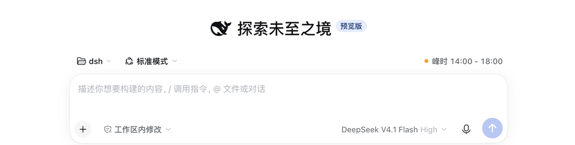
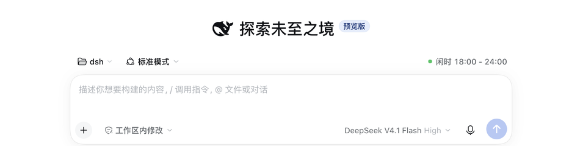
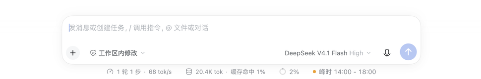
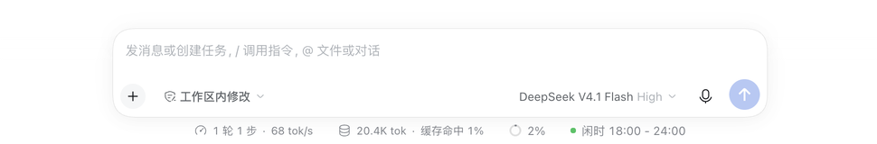
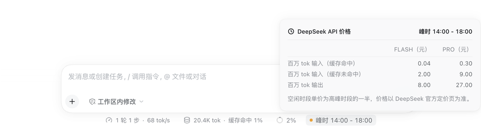
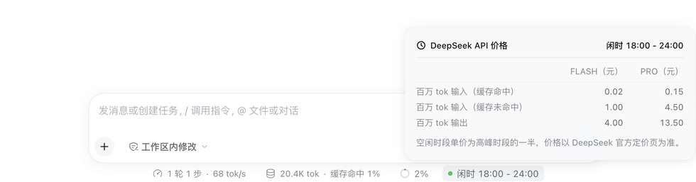

# DeepSeek 峰谷时段 · DSH 插件

[](https://www.npmjs.com/package/dsh-plugin-deepseek-peak-hours)
[](https://www.npmjs.com/package/dsh-plugin-deepseek-peak-hours)
[](./LICENSE)
[](https://github.com/hifengzy/dsh-plugin-deepseek-peak-hours/stargazers)
[](https://github.com/hifengzy/dsh-plugin-deepseek-peak-hours/actions/workflows/ci.yml)

[English](./README.md) · **简体中文**

一个轻量的 DeepSeek Harness（DSH）插件：在输入框底部实时显示 DeepSeek API 当前按**峰时**还是**闲时**计费，点击徽标即可查看该时段的 **FLASH / PRO 价格表**。样式取自 DSH 内置主题，与「上下文已用 x%」等内置读数排在同一行。

```
峰时 09:00 - 12:00     ← 点击后弹出价格表
```

## 它做什么

| 位置 | 出现条件 | 具体位置 |
| --- | --- | --- |
| `conversation.composer.dock` | 已有会话（输入框停靠在底部） | 输入框卡片下方统计行，内置「上下文已用 x%」的右侧 |
| `conversation.hero.options` | 新会话首页（空白会话） | 输入框卡片上方选项行的右侧，与工作区、预设控件同排 |

- **文案**：峰时显示 `峰时 09:00 - 12:00`，闲时显示 `闲时 18:00 - 24:00`；跨夜与整日空闲显示真实区间，如 `00:00 - 09:00`、`18:00 - 24:00`、`00:00 - 24:00`。
- **点击**：弹出当前时段的价目表 —— 行为「百万 tok 输入（缓存命中）」「百万 tok 输入（缓存未命中）」「百万 tok 输出」，列为 `FLASH（元）` 与 `PRO（元）`，并注明「空闲时段单价为高峰时段的一半」。
- **状态点**：峰时琥珀色、闲时绿色，取自 DSH 的 `--dsw-alias-state-warn-primary` 与 `--dsw-alias-state-success-primary`。

## 截图

**新会话首页** —— 徽标在输入框上方选项行的右侧，与工作区、预设按钮同为 28px 高。左为峰时，右为闲时。




**已有会话** —— 徽标是输入框下方统计行的最后一个读数，紧挨「上下文已用 x%」右侧，保持该行 22px 的高度。




**点击查看价格** —— 弹层列出当前时段的 FLASH 与 PRO 单价，并注明空闲时段单价为高峰时段的一半。




## 时段与价格（官方定义，非臆造）

时段逐字取自 DeepSeek 官方定价页：

> 空闲时段价格为高峰时段价格的一半。北京时间周一至周五（不含中国法定节假日）9:00 - 12:00、14:00 - 18:00 为高峰时段；其余时段，包括周末及中国法定节假日全天均为空闲时段。

- 官方定价页：<https://api-docs.deepseek.com/zh-cn/quick_start/pricing/>
- 2026 年节假日：国务院办公厅《关于 2026 年部分节假日安排的通知》（国办发明电〔2025〕7 号）<https://www.gov.cn/zhengce/zhengceku/202511/content_7047091.htm>
- 2027 年节假日：国务院办公厅《关于 2027 年部分节假日安排的通知》（国办发明电〔2026〕10 号）<https://www.gov.cn/zhengce/zhengceku/202611/content_7085102.htm>

价格（元 / 百万 tokens，与官方页 2026-11-16 一致）：

| | FLASH 峰时 | FLASH 闲时 | PRO 峰时 | PRO 闲时 |
| --- | --- | --- | --- | --- |
| 输入（缓存命中） | 0.04 | 0.02 | 0.30 | 0.15 |
| 输入（缓存未命中） | 2.00 | 1.00 | 9.00 | 4.50 |
| 输出 | 8.00 | 4.00 | 27.00 | 13.50 |

背景：峰谷分时定价自 2026-08-17 起生效，2026-08-23 起周六、周日全天不再区分峰谷，FLASH 系列自 2026-09-10 12:00（北京时间）起按上表价格计费。**官方改价后需要更新插件**（见下文）。

## 安装

在 DSH 打开 **插件 → 添加插件**，填入 npm 包名：

```
dsh-plugin-deepseek-peak-hours
```

也可以直接填本仓库目录（本地开发）。插件作用于整个 profile，重启后依然生效；安装后刷新页面即可。

## 设计与性能

- **单定时器，不轮询**：只在下一个时段边界（北京时间 00:00 / 09:00 / 12:00 / 14:00 / 18:00）唤醒一次，一天最多 5 次；标签页重新可见或睡醒后按当前时钟补算。
- **零网络请求**：时段规则、节假日、价目表全部打包在插件里。
- **零依赖**：只用浏览器模块表里的 `react` / `react-dom`，不引用 `@deepseek-ai/dsh-client-ui-primitives` 等会随时变化的 DSH Client 包。
- **跟随所在行的原生几何**：在输入框统计行高 22px，与「上下文已用」及统计胶囊一致；在新会话选项行高 28px、次级墨色，与旁边的工作区、预设、工作树按钮一致。
- **原生样式**：颜色、圆角、阴影、字号全部走 `--dsw-*` / `--dsh-*` 主题 token，亮暗主题自动适配；弹层与内置统计弹层同款（12px 内边距、`--dsw-radius-lg`、`elevation-prominent`、1100 层级、Esc 与点击外部关闭）。
- **固定北京时间**：计费规则由北京时间定义，因此始终按 `Asia/Shanghai` 计算，与机器时区无关（`TZ=America/New_York` 下测试同样通过）。
- **可干净卸载**：样式以 React 元素形式渲染、随组件卸载移除；定时器与监听器都在 effect 清理函数中释放。

## 已知限制

- **无会话的冷启动首页不显示**：没有任何会话时，DSH 在输入框下方不开放任何插件挂载位；选中或新建会话后徽标出现（与内置「上下文已用」的可见性一致）。
- **节假日数据覆盖 2026–2027**：之后年份退化为「周一至周五 09:00-12:00、14:00-18:00 峰时」的普通规则，周末仍然正确。国务院发布新一年安排后，把新区间追加到 `client.js` 的 `HOLIDAY_RANGES` 并发版即可。
- **价格是静态快照**：官方调价后更新 `client.js` 的 `PRICES`；插件不抓取网页。

## 开发

```bash
npm test        # 时段、节假日、边界、槽位与词典接线
npm run test:tz # 在非北京时区下重跑同一套测试
```

文件结构：

```
client.js            # 全部功能：时段计算 + 徽标 + 价格弹层（无构建步骤）
index.js             # Host 半边，不注册任何资源
cordis.patch.yml     # 插入 deepseek-peak-hours 这一行
locale/{zh,en}.json  # 插件管理页的标题与描述
icon.svg             # 36×36 插件图标（时钟 + 峰时扇形）
assets/icon-180.png  # 180×180 市场卡片图标
test/                # node --test 测试
```

时段计算被 `/* #region schedule */` 标记包围，测试直接从 `client.js` 取出这段纯函数执行，因此这份逻辑只有一份实现。

## 许可证

[MIT](./LICENSE)

[](https://github.com/deepseek-ai/deepseek-harness)
